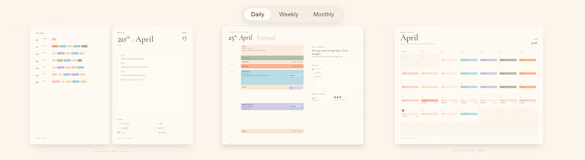
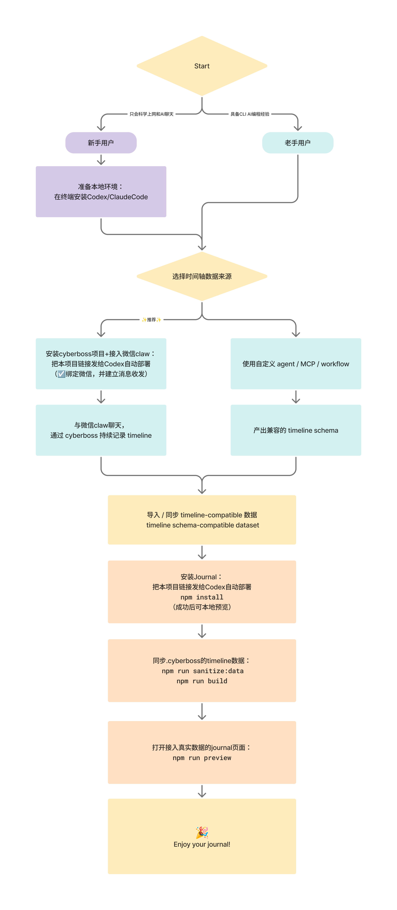

# 📓 Journal

> “让我们和 AI 对话记录，成为有温度的纸质感手帐。”



在线体验：<https://bombomlab.github.io/Journal/>

---

## ✨ Intro

`journal` 是一个前端展示层，把结构化的时间轴事件渲染成 `daily / weekly / monthly` 三种视图的手账本。

## 💡 你可以用 Journal 做什么？

| 你想做的事 | Journal 的呈现方式 |
| --- | --- |
| 回看一天发生了什么 | 用 Daily 视图查看当天的时间轴、日记与待办 |
| 从更长时间范围回顾生活 | 用 Weekly / Monthly 视图浏览每日记录的聚合结果 |
| 给自己的 Agent 增加可视化界面 | 将兼容的数据输出接入 Journal 前端 |
| 先体验，再决定如何接入 | 直接浏览在线演示，或在本地运行仓库自带的示例数据 |

适合希望回顾 AI 对话衍生记录的个人用户，以及已有数据生产流程、需要手帐展示界面的 Agent / workflow 开发者。

### Journal中展示了哪些种类的数据？

依赖Timeline Schema三类数据输入：

| Input | 说明 | 是否必需 |
| --- | --- | --- |
| `timeline` | 带时间跨度的事件记录 | 必需 |
| `diary` | 每日总结与条目 | 推荐 |
| `todo` | 当天待办清单 | 可选 |

### 这些数据从何而来？

| Layer | 说明 | 是否可替换 |
| --- | --- | --- |
| `timeline schema` | `journal` 依赖的数据契约 | 当前强依赖 |
| `timeline producer` | 生成 timeline 数据的上游实现 | 可以自定义 |
| `cyberboss` | 一种 timeline producer，也可提供完整 runtime | ✨推荐 |

---

## 🧭 Guided flow



## 🚪 Data

`journal` 默认消费一套 **timeline-compatible** 的结构化数据。只要数据结构满足以下契约，就可以直接接入：

- [Timeline schema](docs/schemas/timeline.md)
- [Diary schema](docs/schemas/diary.md)
- [Todo schema](docs/schemas/todo.md)

你可以通过两种方式接入：

1. 使用 `cyberboss`
- 默认推荐路径
- 适合希望直接复用现成 runtime 和数据生产能力的用户

2. 使用你自己的 agent / MCP / workflow
- 适合不想引入 `cyberboss` runtime 的用户
- 前提是最终能产出兼容的 `timeline schema`

换句话说，`journal` 可以和 `cyberboss runtime` 解耦，但不能和 `timeline schema` 解耦。

---

## 🔗 仓库

**包含：**

- Journal 前端源码
- 脱敏 sample data：[`data/public/`](data/public/)
- build / sanitize / preview 脚本
- 公开数据契约文档：[`docs/schemas/`](docs/schemas/)

**不包含（属于cyberboss项目范畴）：**

- 原始聊天记录的导入与解析
- 从对话到 `Event / Summary / Todo` 的完整私有提取流程
- 真实个人数据

> 如果你已经有兼容的 `timeline / diary / todo` 数据，可以直接接入这个前端，无需采用 `cyberboss` 运行时。

---
## 🔗 Related repositories

`journal` 基于以下上游项目的思路与结构继续开发：

| 项目 | 角色 | 链接 |
| --- | --- | --- |
| 数据生产者的一种默认实现 | `cyberboss` | https://github.com/WenXiaoWendy/cyberboss |
| `journal` 依赖的数据契约 | `timeline-for-agent` | https://github.com/WenXiaoWendy/timeline-for-agent |

如果这些项目对你有帮助，建议顺手给原作者点个 Star ⭐

---
## 🛠️ 兼容性说明

| 项目 | 当前值 |
| --- | --- |
| `schemaVersion` | `journal-v1` |
| 时区 | `Asia/Shanghai` |
| 数据风格 | timeline-compatible（默认由 cyberboss 产出） |

- `timeline` 是当前前端的核心依赖，字段变化会直接影响渲染
- `journal` 没有定义独立于 `timeline` 之外的另一套数据模型
- `cyberboss` 是一个默认上游实现，但不是唯一实现
- `diary` markdown 格式较轻，后续可能继续演进
- `weekly / monthly` 由 daily 聚合得出，上游字段变化会联动影响

---

## 🗂️ 项目结构

```text
src/                前端 UI、runtime entry、浏览器侧数据组织
data/public/        脱敏 sample timeline、diary、todos
data/private-source/  本地私有源目录（开源仓中留空）
scripts/            build、sanitize、preview 脚本
public/             浏览器入口与编译产物
docs/schemas/       timeline / diary / todo 数据契约
```

---

## 🚀 快速开始

### 本地运行

准备 Git、Node.js 和 npm，在终端执行：

```bash
git clone https://github.com/BomBomLab/Journal.git
cd Journal
npm install
npm run build
npm run preview
```

打开：<http://localhost:8767/Journal.html>

默认使用仓库内的示例数据，无需先配置 cyberboss。

如果默认端口被占用：

```bash
npm run preview -- 8768
```

随后打开：<http://localhost:8768/Journal.html>

修改源码或输入数据后，请重新执行 `npm run build`，再刷新页面。

## 🔌 接入自己的数据

构建脚本支持通过环境变量指定数据来源：

| 环境变量 | 默认值 | 用途 |
| --- | --- | --- |
| `JOURNAL_TIMELINE_STATE_FILE` | `data/public/timeline-state.json` | 时间轴 JSON |
| `JOURNAL_TODOS_FILE` | `data/public/todos.json` | 待办 JSON |
| `JOURNAL_DIARY_DIR` | `data/public/diary` | 日记 Markdown 目录 |
| `JOURNAL_SAMPLE_MODE` | `true` | 是否标记为示例数据 |

在 macOS / Linux 中，可在仓库根目录执行以下命令。请将路径替换为实际位置：

```bash
JOURNAL_TIMELINE_STATE_FILE="/absolute/path/timeline-state.json" \
JOURNAL_TODOS_FILE="/absolute/path/todos.json" \
JOURNAL_DIARY_DIR="/absolute/path/diary" \
JOURNAL_SAMPLE_MODE=false \
npm run build

npm run preview
```

数据格式参见：

- [Timeline schema](docs/schemas/timeline.md)
- [Diary schema](docs/schemas/diary.md)
- [Todo schema](docs/schemas/todo.md)

虽然展示层将 diary / todo 视为推荐或可选内容，当前构建脚本仍会读取待办文件与日记目录，请准备对应输入。

### 数据与发布

构建过程会把输入数据写入 `src/data.generated.js`，并打包到 `public/runtime.js`。发布这些文件也会发布其中的数据。

接入个人记录后，请检查生成文件与 Git 差异，避免将私人内容提交到公开仓库或部署到公开网站。`JOURNAL_SAMPLE_MODE=false` 只改变示例标记，不会自动脱敏或增加访问控制。

## ❓ FAQ

<details>
<summary>可以直接导入原始 AI 聊天记录吗？</summary>

当前仓库提供展示前端，不包含原始聊天记录的导入、解析与完整提取流程。需要先由上游工具生成符合数据契约的时间轴、日记与待办，再接入 Journal。

</details>

<details>
<summary>必须安装 cyberboss 吗？</summary>

不必须。cyberboss 是推荐的上游实现之一；你也可以使用自己的 Agent、MCP 或 workflow，只要最终输出符合 Journal 使用的数据契约。

</details>

<details>
<summary>为什么修改数据后页面没有变化？</summary>

数据在构建时打包到 runtime 中。修改输入文件后，需要重新运行 `npm run build` 并刷新页面；仅启动预览服务不会重新构建数据。

</details>

<details>
<summary>日、周、月视图需要分别准备数据吗？</summary>

不需要分别维护三套记录。周视图与月视图由每日数据聚合得到。

</details>

<details>
<summary>可以用于商业项目吗？</summary>

当前采用 Source-Available 许可，允许范围以仓库的 [LICENSE](LICENSE) 为准。商业用途需要事先获得权利人的书面许可；第三方及上游内容还需遵守各自的授权要求。

</details>

## ⚖️ License

Journal 的原创前端与 UI 设计采用 **Source-Available** 授权：

- ✅ 允许：个人学习、非商用修改与自用
- ❌ 禁止：任何形式的商业用途

本项目同时参考了以下上游项目的思路与结构，复用代码时请同步确认其 license：

- [`cyberboss`](https://github.com/WenXiaoWendy/cyberboss)
- [`timeline-for-agent`](https://github.com/WenXiaoWendy/timeline-for-agent)
